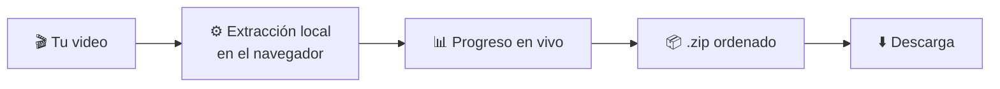

<div align="center">


<br />
<a href="https://frameo-flax.vercel.app/app"></a>
&nbsp;
<a href="https://frameo-flax.vercel.app"></a>
 
<br /><br />
 


</div>
<br />
## ✦ ¿Qué es Frameo?
 
**Frameo** separa un video en sus frames, directamente en tu navegador, y te entrega todo en un `.zip` con las imágenes numeradas y ordenadas.
 
Sin cuentas, sin servidores, sin subir nada. Cargas, procesas y descargas.
 
```text
mi_video.zip
├── frame_00001.png
├── frame_00002.png
├── frame_00003.png
└── ...
```
 
Los nombres llevan **ceros a la izquierda**, así cualquier explorador de archivos los ordena bien.
 
<br />
## ✦ Tres pasos. Cero subidas.
 
<table>
  <tr>
    <td width="33%" valign="top">
      <h3>01 · Carga</h3>
      Selecciona o arrastra un video desde tu computador. Frameo lo lee de forma local en el navegador.
    </td>
    <td width="33%" valign="top">
      <h3>02 · Extrae</h3>
      Elige PNG o JPG y la frecuencia de extracción. Verás el progreso mientras se procesan los cuadros.
    </td>
    <td width="33%" valign="top">
      <h3>03 · Descarga</h3>
      Recibe un <code>.zip</code> con frames numerados: <code>frame_00001.png</code>, <code>frame_00002.png</code>…
    </td>
  </tr>
</table>

 
<br />
## ✦ Características
 
<table>
  <tr>
    <td width="50%" valign="top">
      <b>🔒 100% local</b><br />
      El video nunca se sube a un servidor. Todo ocurre en tu dispositivo.
    </td>
    <td width="50%" valign="top">
      <b>🖼️ PNG o JPG</b><br />
      Calidad sin pérdida o archivos más livianos, tú decides.
    </td>
  </tr>
  <tr>
    <td valign="top">
      <b>🎚️ Todos o cada X</b><br />
      Controla la frecuencia: extrae todos los frames o uno cada X.
    </td>
    <td valign="top">
      <b>🔢 ZIP ordenado</b><br />
      Nombres con padding para que se ordenen bien en cualquier sistema.
    </td>
  </tr>
  <tr>
    <td valign="top">
      <b>📊 Progreso visible</b><br />
      Sabes en qué punto va la extracción en todo momento.
    </td>
    <td valign="top">
      <b>🙅 Sin cuentas ni login</b><br />
      Abres la herramienta y listo. Sin registro, sin backend.
    </td>
  </tr>
</table>
<br />
## ✦ Animaciones
 
La web incluye animaciones propias hechas en HTML, CSS y JS, que explican el proceso de forma visual. Cada una funciona también como demo independiente:
 
| Demo | Qué muestra |
|---|---|
| [`frameo-hero-animacion.html`](public/frameo-hero-animacion.html) | La animación principal de la portada |
| [`frameo-hoja-contactos.html`](public/frameo-hoja-contactos.html) | Escaneo frame por frame, como una hoja de contactos |
| [`frameo-tira-pelicula.html`](public/frameo-tira-pelicula.html) | La tira que se separa en cuadros individuales |
 
<br />
## ✦ Stack tecnológico
 
Aplicación web estática hecha con **TypeScript y JavaScript moderno**. No hay backend ni base de datos.
 
| Tecnología | Para qué se usa |
|---|---|
| **Astro 7** | Páginas y generación estática |
| **React 19** | Componentes interactivos y la herramienta principal |
| **TypeScript** (estricto) | Lógica de la aplicación, como el extractor de video |
| **JavaScript / JSX** | Componentes visuales auxiliares |
| **HTML + CSS** | Estructura, estilos y animaciones |
 
> La funcionalidad central vive en **`frame-extractor.ts`**. TypeScript estricto se configura en `tsconfig.json` y Astro se integra con React en `astro.config.mjs`.
 
<details>
<summary><b>📁 Composición del código</b></summary>
<br />
| Tipo | Cantidad |
|---|---|
| Componentes / páginas `.astro` | 7 |
| Componentes React `.tsx` | 3 |
| Componentes `.jsx` | 2 |
| Módulo TypeScript | 1 |
| Archivos CSS | 4 |
| Demos HTML independientes | 3 |
 
</details>
<br />
## ✦ Ejecutar en local
 
```bash
git clone https://github.com/JUXCHXX/frameo.git
cd frameo
npm install
npm run dev
```
 
Versión de producción:
 
```bash
npm run build
npm run preview
```
 
Como es un sitio 100% estático, se puede desplegar en Vercel, Netlify o cualquier hosting de archivos estáticos.
 
<br />
## ✦ Identidad de marca
 
<div align="center">
<table>
  <tr>
    <td align="center"></td>
    <td align="center"></td>
    <td align="center"></td>
    <td align="center"></td>
  </tr>
  <tr>
    <td align="center"><b>Menta neón</b><br /><code>#00F5D4</code></td>
    <td align="center"><b>Lima eléctrico</b><br /><code>#C6FF3D</code></td>
    <td align="center"><b>Fondo</b><br /><code>#07070B</code></td>
    <td align="center"><b>Texto</b><br /><code>#FFFFFF</code></td>
  </tr>
</table>
</div>
- **Degradado:** de `#00F5D4` a `#C6FF3D`, en diagonal.
- **Tipografía:** Poppins Bold.
- **Logo:** una **F** cuyo brazo del medio es un símbolo de **play**, dentro de las esquinas de un visor de cámara.
- **Archivos:** `public/logo.svg` (logo horizontal) y `public/isotipo.svg` (icono).
<br />
## ✦ Hoja de ruta
 
- [x] Cargar video (clic y arrastrar y soltar)
- [x] Extracción de frames con progreso
- [x] Descarga en `.zip` con frames numerados
- [x] Selector de formato (PNG / JPG)
- [x] Selector de frecuencia (todos o cada X)
- [x] Publicado en producción
- [ ] Elegir rango de tiempo (desde / hasta)
- [ ] Vista previa de los primeros frames
- [ ] Elegir el FPS de salida
- [ ] Procesamiento por lotes para videos muy pesados
- [ ] Versión PWA para usar sin conexión
<br />
## ✦ Preguntas rápidas
 
<details>
<summary><b>¿Frameo sube mi video a algún servidor?</b></summary>
<br />
No. El procesamiento ocurre en tu navegador y el archivo se queda en tu dispositivo.
</details>
<details>
<summary><b>¿Qué recibo al finalizar?</b></summary>
<br />
Un archivo <code>.zip</code> con imágenes numeradas en orden, por ejemplo <code>frame_00001.png</code>.
</details>
<details>
<summary><b>¿Qué formatos puedo elegir?</b></summary>
<br />
PNG para calidad sin pérdida y JPG para menor peso. También puedes extraer todos los frames o uno cada X.
</details>
<details>
<summary><b>¿Necesito crear cuenta?</b></summary>
<br />
No. Frameo funciona sin cuentas, sin login y sin backend.
</details>
<br />
<div align="center">
<b>Hecho por Juan David Florián Amador</b> · <a href="https://github.com/JUXCHXX">@JUXCHXX</a><br />
Desarrollador fullstack · Fundador de Kyro / Digital Uplink Co
 
<br /><br />
 
<a href="https://frameo-flax.vercel.app"><b>frameo-flax.vercel.app</b></a>
 

</div>
 