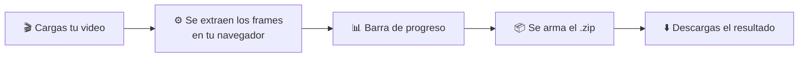

<div align="center">

<br />
### Convierte cualquier video en frames. Sin subir nada.
 
<p>
  <b>Carga un video → espera → descarga un <code>.zip</code> con todos los frames numerados.</b><br />
  Todo ocurre en tu navegador. Tu video <i>nunca</i> sale de tu computador.
</p>
<br />
<a href="https://frameo-flax.vercel.app"></a>
 
<br /><br />
 


 
</div>
<br />
---
 
## ✦ ¿Qué es Frameo?
 
**Frameo** es una herramienta web que separa un video en sus frames y te entrega todo en un solo `.zip`, con las imágenes ordenadas y listas para usar.
 
Pensada para quien necesita las imágenes de un video: animadores, editores, estudiantes, investigadores, creadores de datasets o cualquiera que quiera "congelar" cada instante.
 
```
mi_video.zip
├── frame_00001.png
├── frame_00002.png
├── frame_00003.png
└── ...
```
 
Los nombres llevan **ceros a la izquierda**, así cualquier explorador de archivos los ordena bien.
 
---
 
## ✦ Cómo funciona
 

 
1. **Carga** un video desde tu computador (clic o arrastrar y soltar).
2. **Elige** el formato y la frecuencia de extracción.
3. **Espera** mientras ves el progreso en tiempo real.
4. **Descarga** el `.zip` con todos los frames.
---
 
## ✦ Características
 
| | |
|---|---|
| 🔒 **100% local** | El video nunca se sube a un servidor. Todo se procesa en tu navegador. |
| ⚡ **Rápido y simple** | Cargar, esperar, descargar. Sin cuentas, sin pasos de más. |
| 🖼️ **PNG o JPG** | PNG sin pérdida (pesa más) o JPG (pesa menos). |
| 🎚️ **Frecuencia a tu gusto** | Extrae todos los frames o uno cada X. |
| 📊 **Progreso en vivo** | Siempre sabes en qué punto va la extracción. |
| 🛑 **Cancelable** | Puedes detener el proceso a la mitad sin que se cuelgue la página. |
| 🔢 **Orden correcto** | `frame_00001.png`, `frame_00002.png`… ordenados en cualquier sistema. |
| ✨ **Interfaz animada** | Diseño oscuro, moderno y limpio, con animaciones propias. |
 
---
 
## ✦ Principios del proyecto
 
- **Privacidad primero.** Sin servidores, sin bases de datos, sin almacenamiento en la nube.
- **Sin backend.** Es una aplicación web estática.
- **Sin IA.** Es procesamiento de video clásico; no se necesita ningún modelo.
- **Simple de usar.** Nada que estorbe entre tu video y tus frames.
---
 
## ✦ Stack tecnológico
 
Aplicación web estática construida con **TypeScript y JavaScript moderno** dentro del ecosistema web.
 
| Tecnología | Para qué se usa |
|---|---|
| **Astro 7** | Páginas y generación estática |
| **React 19** | Componentes interactivos y la herramienta principal |
| **TypeScript** | Lógica estricta de la aplicación (extractor de video) |
| **JavaScript / JSX** | Componentes visuales auxiliares |
| **HTML + CSS** | Estructura, estilos y animaciones |
 
> TypeScript está en modo estricto (`tsconfig.json`) y Astro se integra con React desde `astro.config.mjs`.
> La funcionalidad central vive en **`frame-extractor.ts`**.
 
<details>
<summary><b>📁 Composición del código</b></summary>
<br />
| Tipo | Cantidad |
|---|---|
| Componentes / páginas `.astro` | 7 |
| Componentes React `.tsx` | 3 |
| Componentes `.jsx` | 2 |
| Módulo TypeScript | 1 |
| Archivos CSS | 4 |
| Demos HTML independientes | 3 |
 
</details>
---
 
## ✦ Ejecutar en local
 
```bash
# 1. Clona el repositorio
git clone https://github.com/JUXCHXX/frameo.git
cd frameo
 
# 2. Instala las dependencias
npm install
 
# 3. Inicia el servidor de desarrollo
npm run dev
```
 
Para generar la versión de producción:
 
```bash
npm run build
npm run preview
```
 
Como es un sitio 100% estático, se puede desplegar en Vercel, Netlify o cualquier hosting de archivos estáticos.
 
---
 
## ✦ Identidad de marca
 
<div align="center">
| Menta neón | Lima eléctrico | Fondo | Texto |
|:---:|:---:|:---:|:---:|
|  |  |  |  |
| `#00F5D4` | `#C6FF3D` | `#07070B` | `#FFFFFF` |
 
</div>
- **Degradado:** de `#00F5D4` a `#C6FF3D`, en diagonal.
- **Tipografía:** Poppins Bold.
- **Logo:** una **F** cuyo brazo del medio es un símbolo de **play**, dentro de las esquinas de un visor de cámara.
---
 
## ✦ Hoja de ruta
 
- [x] Cargar video (clic y arrastrar y soltar)
- [x] Extracción de frames con barra de progreso
- [x] Descarga en `.zip` con frames numerados
- [x] Selector de formato (PNG / JPG)
- [x] Selector de frecuencia
- [x] Publicado en producción
- [ ] Elegir rango de tiempo (desde / hasta)
- [ ] Vista previa de los primeros frames
- [ ] Elegir el FPS de salida
- [ ] Procesamiento por lotes para videos muy pesados
- [ ] Versión PWA para usar sin conexión
---
 
## ✦ Autor
 
<div align="center">
Hecho por **Juan David Florián Amador** · [@JUXCHXX](https://github.com/JUXCHXX)
 
Desarrollador fullstack · Fundador de **Kyro / Digital Uplink Co**
 
<br />
<a href="https://frameo-flax.vercel.app"><b>frameo-flax.vercel.app</b></a>
 
<sub>Tu video, tus frames, tu privacidad.</sub>
 
</div>
 